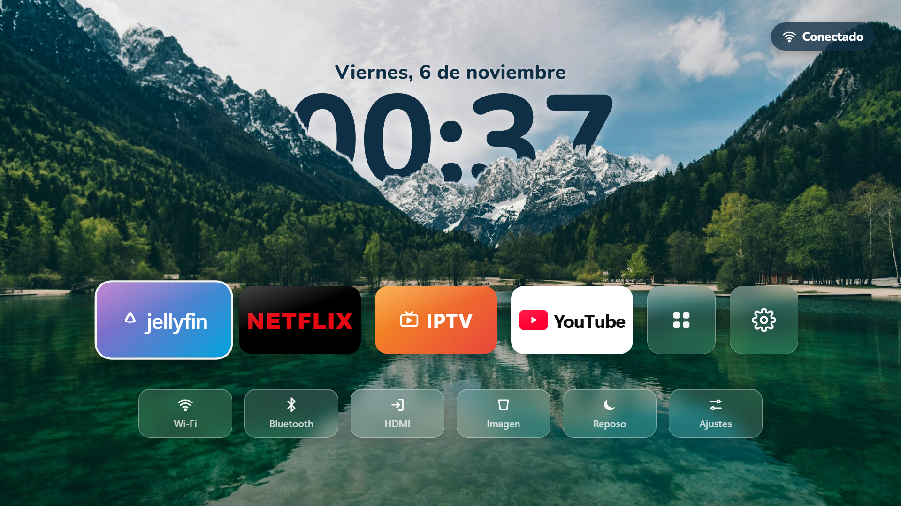
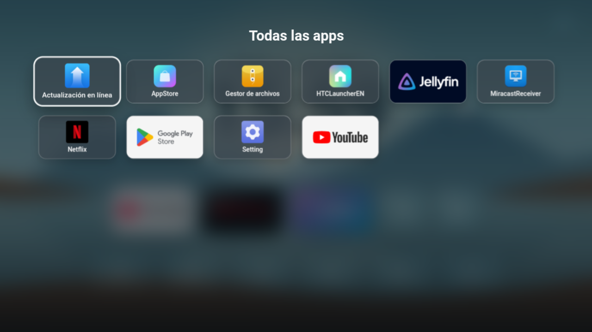

# Inicio — a beautiful home screen for the Magcubic HY300 projector

🇪🇸 [Leer en español](README.md)

An Apple‑style home screen for the **Magcubic HY300** projector (Android 11). It also works on other Android TV sets and boxes.



- A lake and mountains wallpaper with **the clock hidden behind the mountains** (depth effect).
- **Bold, dark‑blue** time and date, easy to read when projected on a white wall.
- Big tiles for **Jellyfin, Netflix, IPTV and YouTube**, plus "All apps" and Settings.
- **Wi‑Fi** (shows your network name) and **Bluetooth** (shows the connected device, e.g. headphones) buttons in the top‑right corner. Select them with the remote to open their settings.
- Projector shortcuts row: **HDMI**, **Imagen** (focus/keystone), **Reposo** (screensaver) and **Ajustes** (settings).
- Everything works with the remote's arrows and OK button.

> The interface is in Spanish. All the text is in `hy300-launcher/assets/index.html` if you want to translate it.



## Install

You need a computer with **ADB** ([Android platform-tools](https://developer.android.com/tools/releases/platform-tools)) and a USB cable.

1. On the projector, go to **Settings → About** and press **Build number** 7 times to enable Developer options.
2. In **Developer options**, turn on **USB debugging**. Connect the projector to the computer and accept the **"Allow USB debugging?"** prompt.
3. Download `Inicio-HY300.apk` from [Releases](../../releases) and install it:
   ```
   adb install -r Inicio-HY300.apk
   ```
4. Set it as the home screen:
   ```
   adb shell cmd package set-home-activity com.hy300.inicio/.MainActivity
   ```
5. Press the **Home** button on the remote.

To go back to the projector's original home screen:
```
adb uninstall com.hy300.inicio
```

### Optional: make it faster

[`bloatware-quitado.txt`](bloatware-quitado.txt) lists factory apps that can be removed safely. Remove them one by one with:
```
adb shell pm uninstall -k --user 0 PACKAGE.NAME
```
You can bring any of them back with `adb shell cmd package install-existing PACKAGE.NAME`.

### The Netflix update popup at every boot

It comes from the manufacturer's store (AppStore). Open it, go to its settings and turn off **"App update reminder"**.

## App tiles

This app **does not include** Netflix, YouTube, Jellyfin or IPTV: it opens the ones you have installed. If one is missing, you get a message.

| Tile | Packages it looks for (in order) |
|---|---|
| Jellyfin | `org.jellyfin.androidtv`, `org.jellyfin.mobile` |
| Netflix | `com.netflix.ninja`, `com.netflix.mediaclient` |
| IPTV | `com.nst.iptvsmarterstvbox` (IPTV Smarters Pro) |
| YouTube | `com.google.android.youtube.tv`, `com.google.android.youtube`, `com.teamsmart.videomanager.tv` |

On the HY300 the Netflix TV app doesn't work because the device isn't Netflix‑certified. The phone version does work.

## On other Android TVs

There's a version made for TVs, with the TV's **Inputs** and **Picture** buttons: [inicio-android-tv](https://github.com/dn0z1986/inicio-android-tv).

## Customize and build

The whole screen is a web page (`hy300-launcher/assets/index.html`) inside a tiny Android app (`MainActivity.java`), so you can change the design without knowing Android. To try it in a browser, open `index.html` and use the keyboard arrows.

To build the APK on Windows you need **JDK 17** and the **Android SDK** (build-tools 34 and platform 34). The script looks for them in `%LOCALAPPDATA%\hy300-tools\jdk17` and `%LOCALAPPDATA%\hy300-tools\sdk`; if yours are elsewhere, edit the first lines of `build.ps1`. Then:
```
powershell -ExecutionPolicy Bypass -File hy300-launcher\build.ps1
```
The script creates its own signing key (`inicio.keystore`) if there isn't one.

**Change the wallpaper:** replace `assets/fondo.jpg` (1920×1080) and cut out the mountains that cover the clock again:
```
powershell -ExecutionPolicy Bypass -File hy300-launcher\tools\recortar-montanas.ps1
```

## Credits

- Wallpaper: Lake Jasna (Slovenia), from [Unsplash](https://images.unsplash.com/photo-1559310589-2673bfe16970), under the [Unsplash License](https://unsplash.com/license).
- Font: [Nunito](https://fonts.google.com/specimen/Nunito), SIL Open Font License.
- Netflix, YouTube, Jellyfin and IPTV Smarters are trademarks of their owners. This project is not affiliated with them.
