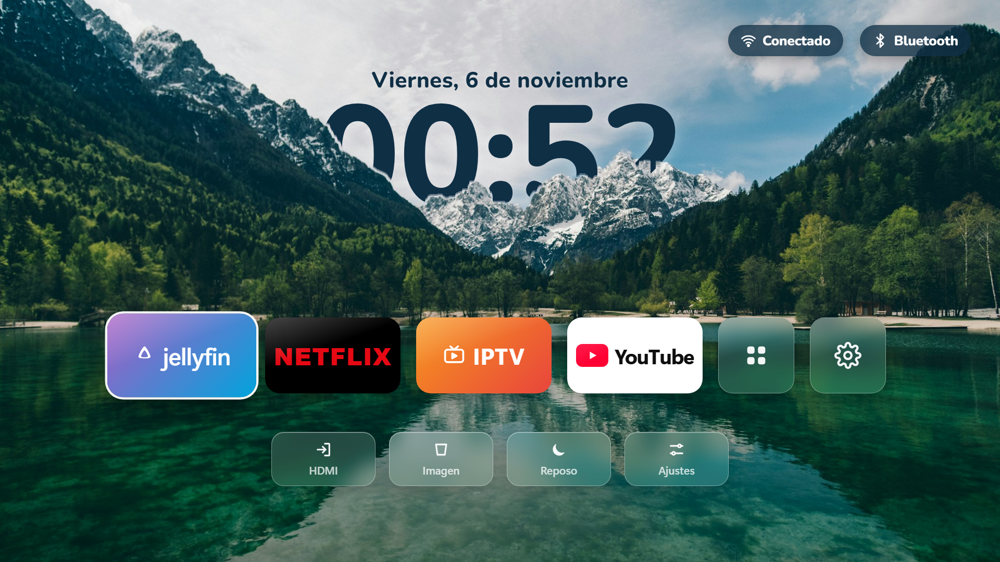
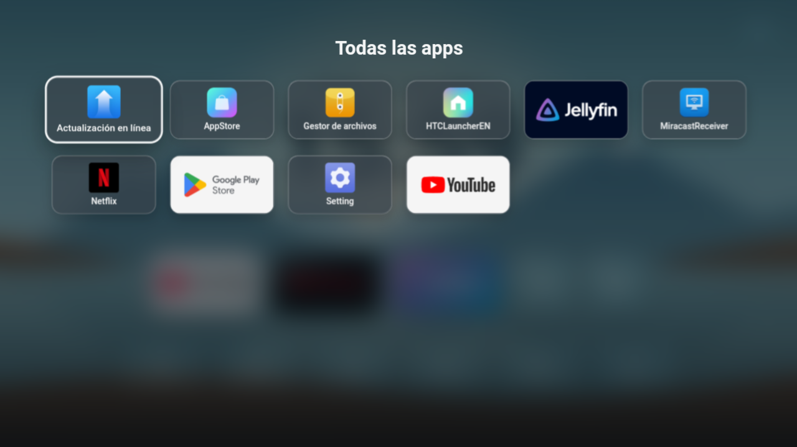

# Inicio — pantalla de inicio bonita para el proyector Magcubic HY300

Una pantalla de inicio "tipo Apple" para el proyector **Magcubic HY300** (Android 11), que también sirve en otras teles y cajas Android TV.



- Fondo de un lago con montañas, y **la hora escondida detrás de las montañas** (efecto profundidad).
- Hora y fecha en **azul oscuro y gruesas**, para que se lean bien proyectadas sobre una pared blanca.
- Botones grandes para **Jellyfin, Netflix, IPTV y YouTube**, más "Todas las apps" y Ajustes.
- Arriba a la derecha, botones de **Wi‑Fi** (con el nombre de tu red) y **Bluetooth** (con el aparato conectado, por ejemplo unos auriculares). Se eligen con el mando y abren sus ajustes.
- Fila de accesos rápidos del proyector: **HDMI**, **Imagen** (enfoque/trapecio), **Reposo** y **Ajustes**.
- Todo se maneja con las flechas y el OK del mando.



## Instalarlo

Necesitas un ordenador con **ADB** (las [platform-tools de Android](https://developer.android.com/tools/releases/platform-tools)) y un cable USB.

1. En el proyector, entra en **Ajustes → Acerca de** y pulsa 7 veces en **Número de compilación** para activar las Opciones de desarrollador.
2. En **Opciones de desarrollador**, activa **Depuración USB**. Conecta el proyector al ordenador y acepta el aviso **"¿Permitir depuración USB?"**.
3. Descarga `Inicio-HY300.apk` de la sección [Releases](../../releases) e instálalo:
   ```
   adb install -r Inicio-HY300.apk
   ```
4. Ponlo como pantalla de inicio:
   ```
   adb shell cmd package set-home-activity com.hy300.inicio/.MainActivity
   ```
5. Pulsa el botón **Inicio** del mando.

Para volver a la pantalla original del proyector:
```
adb uninstall com.hy300.inicio
```

### Opcional: dejarlo más rápido

En [`bloatware-quitado.txt`](bloatware-quitado.txt) está la lista de apps de fábrica que se pueden quitar sin romper nada. Se quitan una a una así:
```
adb shell pm uninstall -k --user 0 NOMBRE.DEL.PAQUETE
```
Se pueden recuperar cuando quieras con `adb shell cmd package install-existing NOMBRE.DEL.PAQUETE`.

### El aviso de actualización de Netflix al encender

Lo lanza la tienda del fabricante (AppStore). Ábrela, entra en sus ajustes y desactiva **"Recordatorio de actualización de la aplicación"**.

## Apps de los botones

La app **no trae** Netflix, YouTube, Jellyfin ni IPTV: abre las que tengas instaladas. Si alguna no está, sale un aviso.

| Botón | Paquetes que busca (en orden) |
|---|---|
| Jellyfin | `org.jellyfin.androidtv`, `org.jellyfin.mobile` |
| Netflix | `com.netflix.ninja`, `com.netflix.mediaclient` |
| IPTV | `com.nst.iptvsmarterstvbox` (IPTV Smarters Pro) |
| YouTube | `com.google.android.youtube.tv`, `com.google.android.youtube`, `com.teamsmart.videomanager.tv` |

En el HY300 la versión de TV de Netflix no funciona porque el aparato no está certificado. La versión de móvil sí funciona.

## En otras teles Android TV

Hay una versión preparada para teles, con botones de **Entradas** e **Imagen** de la tele: [inicio-android-tv](https://github.com/dn0z1986/inicio-android-tv).

## Cambiar el diseño y compilar

Toda la pantalla es una página web (`hy300-launcher/assets/index.html`) dentro de una app Android muy pequeña (`MainActivity.java`), así que se puede cambiar el diseño sin saber Android. Para probarla en el navegador, abre `index.html` y usa las flechas del teclado.

Para compilar el APK en Windows hace falta **JDK 17** y el **Android SDK** (build-tools 34 y platform 34). El script los busca en `%LOCALAPPDATA%\hy300-tools\jdk17` y `%LOCALAPPDATA%\hy300-tools\sdk`; si los tienes en otro sitio, cambia las primeras líneas de `build.ps1`. Después:
```
powershell -ExecutionPolicy Bypass -File hy300-launcher\build.ps1
```
El script crea una clave de firma propia (`inicio.keystore`) si no existe.

**Cambiar el fondo:** cambia `assets/fondo.jpg` (1920×1080) y vuelve a recortar las montañas que tapan la hora:
```
powershell -ExecutionPolicy Bypass -File hy300-launcher\tools\recortar-montanas.ps1
```

## Créditos

- Foto del fondo: lago Jasna (Eslovenia), de [Unsplash](https://images.unsplash.com/photo-1559310589-2673bfe16970), con la [licencia de Unsplash](https://unsplash.com/license).
- Tipografía: [Nunito](https://fonts.google.com/specimen/Nunito), con la licencia SIL Open Font License.
- Netflix, YouTube, Jellyfin e IPTV Smarters son marcas de sus dueños. Este proyecto no tiene relación con ellos.
